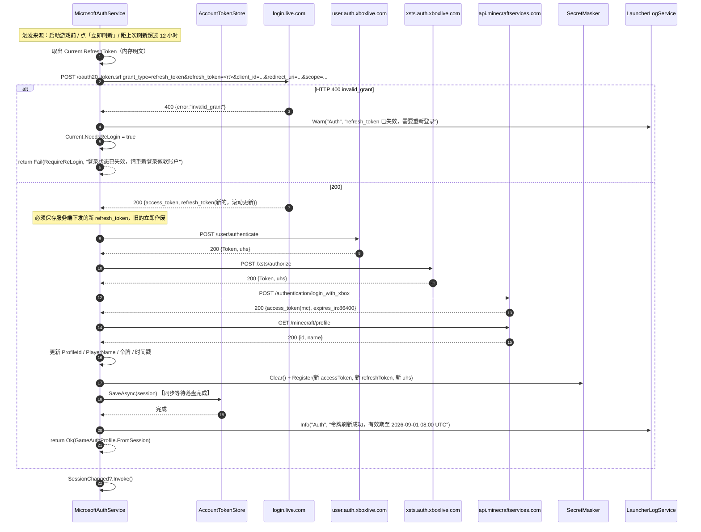
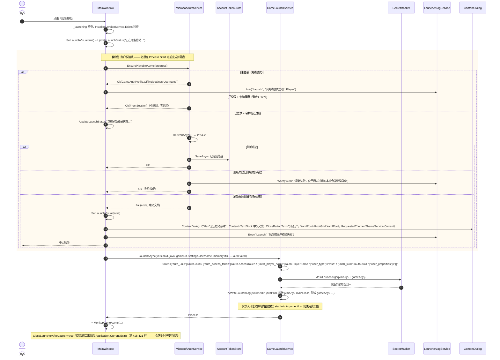
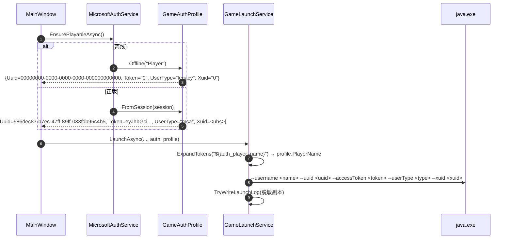
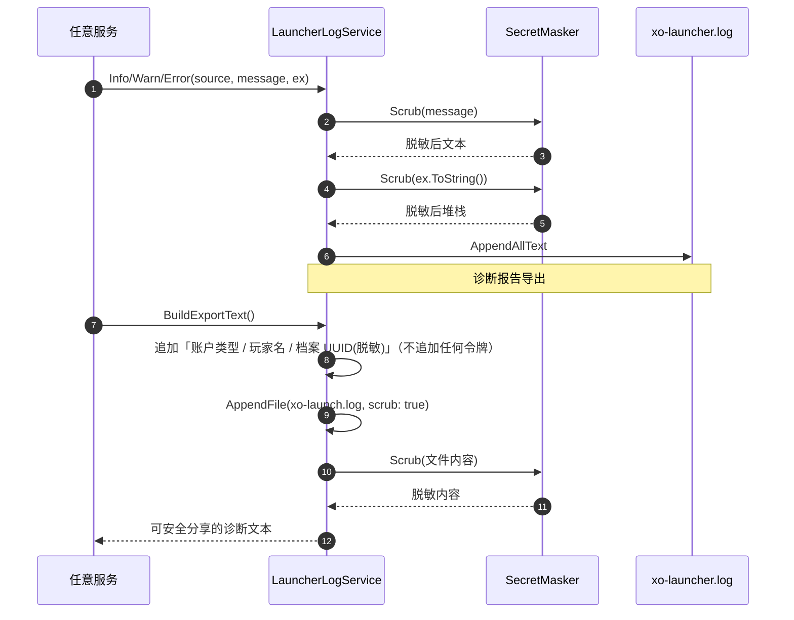
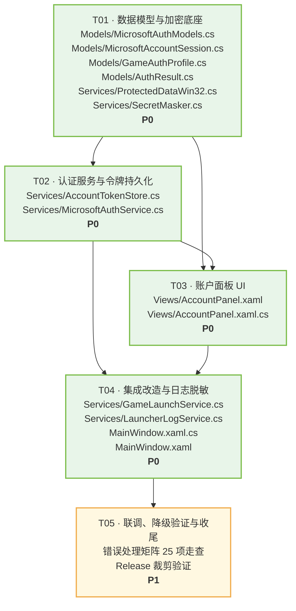

# XO Launcher · 微软正版登录（Microsoft Authentication Scheme）系统设计

> 架构师：高见远（Bob） · 版本 v1.0
> 工程根目录（下文中所有相对路径均相对此目录）：`D:\Users\rmb12\source\repos\XO_Launcher\XO_Launcher\XO_Launcher`
> 命名空间：`XO_Launcher`
>
> ⚠️ 根目录 `XO_Launcher\XO_Launcher\` 下还有一个旧版游离 csproj 与 App.xaml，**不在本次改造范围，禁止修改**。

---

## 0. 调研复核结论（对上游报告的修正与补充）

我逐文件核对了上游调研报告，并在**真实工程上做了编译探针验证**（探针文件已删除，工程可正常构建）。结论如下：

| # | 结论 | 证据 / 验证方式 |
|---|---|---|
| 1 | ✅ `Microsoft.UI.Xaml.Controls.WebView2` **可直接在 XAML 与 code-behind 中使用，无需新增任何 NuGet 包** | 临时新建 `_ProbeView.xaml`（`<controls:WebView2 x:Name="ProbeWebView"/>`）+ code-behind 调用 `EnsureCoreWebView2Async()` / `CoreWebView2.Navigate()`，`dotnet build -c Debug -p:Platform=x64` **0 错误 0 警告通过** |
| 2 | ✅ `Microsoft.Web.WebView2.Core`（`CoreWebView2Environment`、`CoreWebView2` 等）**已可引用** | 同上探针，`using Microsoft.Web.WebView2.Core;` 编译通过 |
| 3 | ❌ **`System.Security.Cryptography.ProtectedData` 不可用**（会报 `CS0103: 当前上下文中不存在名称"ProtectedData"`）。该类型需要额外 NuGet 包 `System.Security.Cryptography.ProtectedData`，**被硬约束禁止** | 探针编译失败，错误码 `CS0103` |
| 4 | ✅ 替代方案一：**P/Invoke `crypt32.dll!CryptProtectData / CryptUnprotectData` + `kernel32.dll!LocalFree`** | 探针编译通过 |
| 5 | ✅ 替代方案二：**WinRT `Windows.Security.Cryptography.DataProtection.DataProtectionProvider("LOCAL=user")`** | 探针编译通过 |
| 6 | ✅ `System.Security.Cryptography.AesGcm`、`System.Net.HttpListener`、`SocketsHttpHandler.SslOptions` 均可用 | 探针编译通过 |
| 7 | ⚠️ **`await WebView2.EnsureCoreWebView2Async()` 必须显式 `using System;`** | 未启用 ImplicitUsings，缺 `using System;` 时报 `CS4036: "IAsyncAction" 不包含 "GetAwaiter" 的定义`（`System.WindowsRuntimeSystemExtensions` 提供扩展方法）。**这是本项目 WebView2 开发的头号踩坑点** |
| 8 | ✅ `LaunchAsync` 全项目**只有一个调用点**（`MainWindow.xaml.cs:267`），改造签名风险极低 | `grep -rn "LaunchAsync"` |
| 9 | ✅ `MainWindow.xaml.cs:418-421`：`CloseLauncherAfterLaunch=true` 且游戏窗口出现后调用 `Application.Current.Exit()` | 已确认，token 必须在 `Process.Start` 之前完成刷新并落盘 |
| 10 | ✅ 主题画笔键名已逐一核准，`AccentOnBrush`（非 `AccentBrush` 的互补色）存在，用于主按钮前景 | `grep -o 'x:Key="[A-Za-z]*Brush"' App.xaml` |
| 11 | ✅ `PublishTrimmed=True`（Release）+ `PublishReadyToRun=True`（Release） | `XO_Launcher.csproj:58-63` |

> **对报告的修正 1**：`Microsoft.Web.WebView2` 的 `Microsoft.Web.WebView2.Core.winmd` 在 `obj/project.assets.json` 中**没有任何 compile 资产**（只在 `lib_manual/net8.0-windows10.0.17763.0/` 下提供 `Microsoft.Web.WebView2.Core.Projection.dll`）。但实测**编译仍可通过** —— 因为 WinAppSDK 的 `Microsoft.UI.Xaml.winmd` 已完整投影了所需的 Core 类型。探针已实证，可放心使用。
>
> **对报告的修正 2**：DPAPI 不能走 `System.Security.Cryptography.ProtectedData`，必须走 P/Invoke 或 WinRT。本设计已给出三级降级链。

---

## Part A · 系统设计

### 1. 实现方案总述

#### 1.1 核心难点

| 难点 | 对策 |
|---|---|
| **回调方式**：非打包应用（`WindowsPackageType=None`）无协议激活、无 AppX 清单 | 采用「WebView2 内嵌导航拦截」为主，「系统浏览器 + 手动粘贴回调 URL」为降级。**不使用本地 HTTP 监听** |
| **令牌安全落盘**：项目零加密基础设施，且 `System.Security.Cryptography.ProtectedData` 不可用 | P/Invoke `CryptProtectData`（CurrentUser 域）→ WinRT `DataProtectionProvider("LOCAL=user")` → 内存会话（不落盘）三级降级 |
| **令牌泄漏到日志与诊断报告** | 引入 `SecretMasker`：已知密文注册表 + JWT/命令行参数正则，双保险作用于 `TryWriteLaunchLog` 与 `LauncherLogService.Write` |
| **设置项高频落盘**：`LauncherSettings.SetValue<T>` 每次赋值即 `Save()` | 令牌**不放进** `LauncherSettings`，独立文件 `account.json`，由 `AccountTokenStore.SaveAsync()` 显式落盘 |
| **启动前必须完成刷新**（`CloseLauncherAfterLaunch`） | `PlayButton_Click` 在 `LaunchAsync` 之前插入 `await EnsurePlayableAsync()`，内部同步完成「刷新 + 落盘 + SessionChanged」 |
| **Release 裁剪（`PublishTrimmed`）下的 JSON 反射序列化** | 所有 DTO 逐字段 `[JsonPropertyName]` 显式标注（对齐 `Models/ModrinthProject.cs` 模板），不使用全局 NamingPolicy；现有 `LauncherSettings.SettingsData` 已验证此路径在裁剪下可用 |
| **SSL 重协商**：XBL / XSTS 端点要求客户端支持 TLS 重协商 | 独立认证 HttpClient 用 `SocketsHttpHandler`（.NET 8 默认支持重协商）；若实测失败，退路为 `SocketsHttpHandler.SslOptions` 显式配置，或换 `HttpClientHandler`。见 §8 风险 R3 |

#### 1.2 回调方式选型（三选一，附推荐与降级链）

| 方案 | 优点 | 缺点 | 结论 |
|---|---|---|---|
| **A. WebView2 内嵌 + NavigationStarting 拦截** | 用户全程留在启动器内；无防火墙弹窗；无需监听端口；拦截即可取 `code` 且可 `e.Cancel = true` 阻止跳转 | 依赖 WebView2 Runtime（Win11 内置，Win10 多数已随 Edge 装）；非打包应用需显式指定 UserDataFolder | **推荐主路径** |
| **B. 系统浏览器 + 本地 HTTP 监听（`HttpListener`）** | 无需 WebView2 | ① 官方 client_id 的 `redirect_uri` 被硬绑定为 `https://login.live.com/oauth20_desktop.srf`，**localhost 回调对该 client_id 无效**，只有自建 Azure 应用才能用；② 会触发 Windows 防火墙「是否允许访问网络」弹窗；③ 需要管理员预留 URL 或用户权限；④ 端口占用冲突 | ❌ **本期不采用**（技术上与官方 client_id 不兼容） |
| **C. 系统浏览器 + 手动粘贴回调 URL** | 零依赖、绝对可靠；PCL2 / HMCL 均有此兜底 | 用户需手动复制地址栏 URL，体验略差 | ✅ **降级路径** |

**最终降级链**：

```
A. WebView2 内嵌拦截
   ├─ 失败条件：CoreWebView2Environment.GetAvailableBrowserVersionString() 返回 null
   │            或 EnsureCoreWebView2Async() 抛异常
   │            或 CoreWebView2 初始化 15s 超时
   └─> C. 系统浏览器 + 手动粘贴回调 URL
        └─ 失败条件：粘贴内容解析不出 code
           └─> 提示「登录已取消 / 网址无效」，回到未登录态
```

`AccountPanel` 内部两个 Grid（`WebViewHost` / `ManualHost`）同层级切换 `Visibility`，**整个过程只在同一个 ContentDialog 内完成** —— 这点是硬约束：WinUI 3 同一 `XamlRoot` 上不允许同时打开两个 ContentDialog，因此绝不能做成「点登录再弹第二个对话框」。

#### 1.3 与现有架构的融合方式

- **服务形态**：`MicrosoftAuthService`（单例 + `Instance`）、`AccountTokenStore`（单例 + `Instance`）、`SecretMasker` / `ProtectedDataWin32`（静态类）—— 完全对齐 `LauncherSettings.Instance`、`DownloadService.Instance`、`JavaRuntimeService.Instance` 的形态。
- **UI 形态**：`Views/AccountPanel.xaml` 为 `UserControl`，内部纯 code-behind + `x:Name` 直接操作控件树，**不引入 MVVM / x:Bind / ViewModel**。沿用 `Views/InstanceSettingsPanel` 的「UserControl 作 ContentDialog 内容 + `Load()` / `Save()`」契约。
- **事件挂载**：`MainWindow` 构造函数中 `MicrosoftAuthService.Instance.SessionChanged += ...`（沿用第 67-72 行的 `+=` 风格）。
- **线程**：后台线程回 UI 一律 `DispatcherQueue.TryEnqueue(...)`，或复用既有 `Services/UiDispatch.cs` 的 `UiDispatch.Run(...)`。
- **主题**：全部 `ThemeResource` 语义画笔；ContentDialog 固定四要素 `XamlRoot = RootGrid.XamlRoot` + `RequestedTheme = ThemeService.Current` + Primary/CloseButtonText + `await ShowAsync()`。
- **日志**：`LauncherLogService.Info/Warn/Error("Auth", ...)`。
- **防回环**：`AccountPanel` 内用 `_syncing` 布尔标志（对齐 `SettingsPage` / `InstanceSettingsPanel` 套路）。
- **零新增 NuGet**：仅使用 `System.Text.Json`、`System.Net.Http`、WinRT 投影与 `DllImport`，全部为框架内置。

---

### 2. 文件清单

#### 2.1 新增文件（9 个）

| 相对路径 | 职责 |
|---|---|
| `Models/MicrosoftAuthModels.cs` | 微软认证链路的全部 DTO（OAuth Token / XBL / XSTS / XErr / MC 登录 / 档案 / 所有权），逐字段 `[JsonPropertyName]` |
| `Models/MicrosoftAccountSession.cs` | 登录会话模型（内存态 + 持久化态），标注哪些字段加密 |
| `Models/GameAuthProfile.cs` | 传给 `GameLaunchService` 的启动身份凭证（正版 / 离线统一抽象） |
| `Models/AuthResult.cs` | 认证结果封装（`Success` / `Profile` / `AuthErrorCode` / 中文 `Message`）+ `AuthErrorCode` 枚举 |
| `Services/ProtectedDataWin32.cs` | DPAPI 封装：P/Invoke `CryptProtectData` 为主，WinRT `DataProtectionProvider` 为降级 |
| `Services/SecretMasker.cs` | 令牌脱敏：已知密文注册表 + JWT / 命令行参数正则 |
| `Services/AccountTokenStore.cs` | 会话的加密持久化（`account.json`），单例，`LoadAsync()` / `SaveAsync()` / `ClearAsync()` |
| `Services/MicrosoftAuthService.cs` | 认证编排：OAuth → XBL → XSTS → MC → 所有权 → 档案；刷新；登出；`EnsurePlayableAsync()`；`SessionChanged` 事件 |
| `Views/AccountPanel.xaml`<br>`Views/AccountPanel.xaml.cs` | 账户面板 UserControl（未登录 / WebView2 登录中 / 手动粘贴降级 / 已登录 四个视觉状态），作为 ContentDialog 内容 |

#### 2.2 需修改的既有文件（5 个）

| 相对路径 | 改动点（行号 / 方法名） | 具体改动 |
|---|---|---|
| `Services/GameLaunchService.cs` | **第 50-57 行** `LaunchAsync(MinecraftVersion, ...)` 重载 | 新增 `GameAuthProfile? auth = null` 参数，透传给主重载 |
| | **第 59-73 行** `LaunchAsync(string versionId, ...)` 主重载 | 在 `windowMode` 之后、`cancellationToken` 之前插入 `GameAuthProfile? auth = null` |
| | **第 208-233 行** tokens 字典 | `auth` 为空时保持现有硬编码（离线）；非空时用 `auth.Uuid / AccessToken / PlayerName / "msa" / Xuid` 填充 `auth_uuid`、`auth_access_token`、`auth_player_name`、`user_type`、`auth_xuid`，`user_properties` 仍为 `"{}"` |
| | **第 379-406 行** `TryWriteLaunchLog` | 写入前对 `jvmArgs` / `gameArgs` 做参数级脱敏（见 §3.5），**不影响** `startInfo.ArgumentList` 的真实值 |
| `Services/LauncherLogService.cs` | **第 116-134 行** `AppendLine` | `message` 与 `exception.ToString()` 写入前统一过一遍 `SecretMasker.Scrub(...)` |
| | **第 152-182 行** `AppendFile` | 新增 `bool scrub = false` 可选参数；开启时对读取内容执行 `SecretMasker.Scrub(...)` |
| | **第 36-87 行** `BuildExportText` | ① 第 56 行附近补充「账户类型」「档案 UUID（脱敏）」两行，**不输出任何令牌**；② 第 71 行 `xo-launch.log` 的 `AppendFile` 调用传 `scrub: true` |
| `MainWindow.xaml.cs` | **第 67 行后**（构造函数事件挂载区） | 新增 `MicrosoftAuthService.Instance.SessionChanged += OnAuthSessionChanged;`（`OnAuthSessionChanged` 内部 `DispatcherQueue.TryEnqueue(RefreshChrome)`） |
| | **第 162-197 行** `RefreshChrome` | 第 167 行 `AccountNameText.Text` 改为 `MicrosoftAuthService.Instance.DisplayName ?? (非空 Username) ?? "Player"`；额外刷新正版徽标 `AccountVerifiedIcon.Visibility` 与 `AccountButton` ToolTip |
| | **第 238-278 行** `PlayButton_Click` | ① 在 `SetLaunchVisual(true)` 之后、`new GameLaunchService(progress)` 之前插入账户校验块（见 §4.3 时序图）；② 第 267-278 行 `LaunchAsync` 调用追加 `auth: auth` |
| | **第 566-584 行** `AccountButton_Click` | 整体替换为「创建 `AccountPanel` → `panel.Load()` → ContentDialog（`Title="账户"`，`PrimaryButtonText="保存"`，`CloseButtonText="关闭"`，`DefaultButton = ContentDialogButton.Close`，`ContentDialogMaxWidth=520`，`ContentDialogMinWidth=480`）→ `await ShowAsync()` → Primary 时 `panel.Save()` → `RefreshChrome()`」 |
| `MainWindow.xaml` | **第 195-206 行** 账户区 StackPanel | 在 `AccountNameText` 之后插入 `FontIcon x:Name="AccountVerifiedIcon" Glyph="&#xE73E;" FontSize="11" Foreground="{ThemeResource AccentBrush}" Visibility="Collapsed"`（正版徽标，已登录时可见），并在 `TextBlock` 与下拉箭头之间插入 `TextBlock x:Name="AccountKindText"`（"微软正版" / "离线"，字体 10，TextSecondaryBrush） |
| `Views/SettingsPage.xaml` / `.xaml.cs` | 可选（P2） | 在「启动器设置」卡片末尾追加一行只读的「账户：微软正版 xxx / 离线 xxx」+「管理…」按钮，复用 `OpenLibraryPage()` 的跨页跳转套路。**本期刊为 P2，不做也可交付** |

> ⚠️ **禁止改动**：`D:\Users\rmb12\source\repos\XO_Launcher\XO_Launcher\XO_Launcher.csproj`（根目录两层下的旧版游离工程）、`XO_Launcher\XO_Launcher\app.manifest`、`XO_Launcher\XO_Launcher\MainWindow.xaml`。

---

### 3. 数据结构与接口

#### 3.1 类图

```mermaid
classDiagram
    class MicrosoftAuthService {
        -const string ClientId
        -const string Scope
        -const string RedirectUri
        -AccountTokenStore _store
        -static readonly HttpClient _http
        -MicrosoftAccountSession? _session
        +static MicrosoftAuthService Instance
        +event Action? SessionChanged
        +MicrosoftAccountSession? Current
        +bool IsSignedIn
        +string DisplayName
        +string AccountKindText
        +Task~string~ BuildAuthorizeUrlAsync()$
        +Task~AuthResult~ CompleteLoginAsync(string code, CancellationToken ct)
        +Task~AuthResult~ RefreshAsync(bool force, CancellationToken ct)
        +void SignOut()
        +Task~AuthResult~ EnsurePlayableAsync(IProgress~string~? progress, CancellationToken ct)
        +Task~AuthResult~ ValidateNowAsync(CancellationToken ct)
        -Task~string~ ExchangeCodeForMsTokenAsync(string code, CancellationToken)
        -Task~string~ RefreshMsTokenAsync(string refreshToken, CancellationToken)
        -Task~XboxAuthResponse~ AuthenticateXblAsync(string msAccessToken, CancellationToken)
        -Task~XboxAuthResponse~ AuthorizeXstsAsync(string xblToken, CancellationToken)
        -Task~MinecraftLoginResponse~ LoginWithXboxAsync(string uhs, string xstsToken, CancellationToken)
        -Task~MinecraftProfileResponse?~ FetchProfileAsync(string mcToken, CancellationToken)
        -Task~bool~ CheckOwnershipAsync(string mcToken, CancellationToken)
        -static HttpClient CreateAuthClient()$
    }

    class AccountTokenStore {
        -const string FileName
        -static readonly JsonSerializerOptions _json
        -MicrosoftAccountSession? _cached
        +static AccountTokenStore Instance
        +string FilePath
        +bool PersistAvailable
        +Task~MicrosoftAccountSession?~ LoadAsync()
        +Task SaveAsync(MicrosoftAccountSession session)
        +Task ClearAsync()
        -static AccountTokenFile ToFile(MicrosoftAccountSession s)$
        -static MicrosoftAccountSession? FromFile(AccountTokenFile? f)$
    }

    class ProtectedDataWin32 {
        +const string Description
        +static bool TryProtect(byte[] plain, out byte[]? cipher)
        +static bool TryUnprotect(byte[] cipher, out byte[]? plain)
        +static Task~byte[]?~ ProtectWinrtAsync(byte[] plain)
        +static Task~byte[]?~ UnprotectWinrtAsync(byte[] cipher)
        -static bool CryptProtectData(ref DATA_BLOB, string?, IntPtr, IntPtr, IntPtr, int, ref DATA_BLOB)
        -static bool CryptUnprotectData(ref DATA_BLOB, IntPtr, IntPtr, IntPtr, IntPtr, int, ref DATA_BLOB)
        -static IntPtr LocalFree(IntPtr)
    }

    class SecretMasker {
        -static readonly object _gate
        -static readonly List~string~ _known
        +static void Register(params string?[] secrets)
        +static void Clear()
        +static string Scrub(string? text)
        +static string Mask(string? secret)
        +static string MaskUuid(string? uuid)
        +static IReadOnlyList~string~ MaskLaunchArgs(IReadOnlyList~string~ args)
    }

    class MicrosoftAccountSession {
        +string ProfileId
        +string PlayerName
        +string MinecraftAccessToken
        +DateTimeOffset MinecraftTokenExpiresAt
        +string XboxUserHash
        +string RefreshToken
        +DateTimeOffset RefreshTokenObtainedAt
        +DateTimeOffset LastRefreshedAt
        +bool OwnsMinecraft
        +bool NeedsReLogin
        +bool MinecraftTokenNearExpiry
        +bool RefreshTokenNearExpiry
    }

    class GameAuthProfile {
        +string PlayerName
        +string Uuid
        +string AccessToken
        +string UserType
        +string Xuid
        +static GameAuthProfile Offline(string username)$
        +static GameAuthProfile FromSession(MicrosoftAccountSession s)$
    }

    class AuthResult {
        +bool Success
        +GameAuthProfile? Profile
        +AuthErrorCode Code
        +string Message
        +Exception? Exception
        +static AuthResult Ok(GameAuthProfile p)$
        +static AuthResult Fail(AuthErrorCode c, string msg, Exception? ex)$
    }

    class AuthErrorCode {
        <<enumeration>>
        None
        Cancelled
        Network
        Timeout
        HttpStatus
        XstsError
        NoProfile
        NoEntitlement
        Json
        CryptoUnavailable
        WebView2Unavailable
        RequireReLogin
        RateLimited
        Unknown
    }

    class AccountPanel {
        -bool _syncing
        -bool _webViewAvailable
        -TaskCompletionSource~string~? _codeTcs
        -MicrosoftAuthService _auth
        +event Action? Changed
        +void Load()
        +void Save()
        -void ShowState(string state)
        -void BeginLogin()
        -void BeginManualLogin()
        -void OnNavigationStarting(CoreWebView2 sender, CoreWebView2NavigationStartingEventArgs e)
        -void OnWebViewInitFailed(Exception ex)
        -Task~void~ FinishLoginAsync(string code)
        -void ShowError(string message)
    }

    class GameLaunchService {
        +Task~Process~ LaunchAsync(string versionId, string? javaPath, string gameDirectory, string username, long memoryMB, string? manifestUrl, DownloadTask? javaTask, bool? autoMatchJava, string? extraJvmArgs, string? extraGameArgs, int? windowWidth, int? windowHeight, string windowMode, GameAuthProfile? auth, CancellationToken cancellationToken)
        -static void TryWriteLaunchLog(...)
    }

    class LauncherLogService {
        +static void Info(string source, string message)
        +static void Warn(string source, string message)
        +static void Error(string source, string message, Exception? ex)
        +static string BuildExportText()
        -static void AppendLine(string level, string source, string message, Exception? ex)
        -static void AppendFile(StringBuilder sb, string path, int maxBytes, bool scrub)
    }

    class MainWindow {
        -void RefreshChrome()
        -async void AccountButton_Click(object, RoutedEventArgs)
        -async void PlayButton_Click(object, RoutedEventArgs)
        -void OnAuthSessionChanged()
    }

    MicrosoftAuthService --> AccountTokenStore : uses
    MicrosoftAuthService --> GameAuthProfile : produces
    MicrosoftAuthService --> AuthResult : returns
    MicrosoftAuthService --> SecretMasker : registers secrets
    MicrosoftAuthService --> ProtectedDataWin32 : via store
    AccountTokenStore --> ProtectedDataWin32 : encrypt/decrypt
    AccountTokenStore ..> MicrosoftAccountSession : persists
    AuthResult --> GameAuthProfile : carries
    AuthResult --> AuthErrorCode : carries
    GameAuthProfile ..> MicrosoftAccountSession : built from
    AccountPanel --> MicrosoftAuthService : drives
    MainWindow --> AccountPanel : hosts in ContentDialog
    MainWindow --> MicrosoftAuthService : SessionChanged / EnsurePlayableAsync
    MainWindow --> GameLaunchService : passes auth
    GameLaunchService --> SecretMasker : masks launch log
    LauncherLogService --> SecretMasker : scrubs messages
```



#### 3.2 DTO 定义（`Models/MicrosoftAuthModels.cs`）

> 严格对齐 `Models/ModrinthProject.cs` 模板：逐字段 `[JsonPropertyName]`，不使用全局 NamingPolicy（Release 裁剪安全性）。
> 每个 DTO 的字段命名与线上 JSON 大小写逐一对应：OAuth 用 snake_case，XBL/XSTS 用 PascalCase，MC 用 camelCase。

```csharp
using System.Collections.Generic;
using System.Text.Json.Serialization;

namespace XO_Launcher.Models
{
    /// <summary>步骤 1：login.live.com/oauth20_token.srf 的成功响应（snake_case）。</summary>
    public class MicrosoftTokenResponse
    {
        [JsonPropertyName("token_type")]    public string TokenType { get; set; } = "";
        [JsonPropertyName("expires_in")]    public long ExpiresIn { get; set; }
        [JsonPropertyName("scope")]         public string Scope { get; set; } = "";
        [JsonPropertyName("access_token")]  public string AccessToken { get; set; } = "";
        [JsonPropertyName("refresh_token")] public string RefreshToken { get; set; } = "";
        [JsonPropertyName("user_id")]       public string UserId { get; set; } = "";
        [JsonPropertyName("foci")]          public string? Foci { get; set; }
    }

    /// <summary>步骤 1 失败时的错误响应（snake_case，HTTP 400）。</summary>
    public class MicrosoftTokenErrorResponse
    {
        [JsonPropertyName("error")]             public string Error { get; set; } = "";
        [JsonPropertyName("error_description")] public string? ErrorDescription { get; set; }
        [JsonPropertyName("correlation_id")]    public string? CorrelationId { get; set; }
    }

    /// <summary>步骤 2（XBL）/ 步骤 3（XSTS）请求体（PascalCase）。</summary>
    public class XboxAuthRequest
    {
        [JsonPropertyName("Properties")]    public XboxAuthProperties Properties { get; set; } = new();
        [JsonPropertyName("RelyingParty")]  public string RelyingParty { get; set; } = "";
        [JsonPropertyName("TokenType")]     public string TokenType { get; set; } = "JWT";
    }

    public class XboxAuthProperties
    {
        [JsonPropertyName("AuthMethod")] public string? AuthMethod { get; set; }
        [JsonPropertyName("SiteName")]   public string? SiteName { get; set; }
        [JsonPropertyName("RpsTicket")]  public string? RpsTicket { get; set; }
        [JsonPropertyName("SandboxId")]  public string? SandboxId { get; set; }

        /// <summary>XSTS 专用：XBL 令牌数组。</summary>
        [JsonPropertyName("UserTokens")] public List<string>? UserTokens { get; set; }
    }

    /// <summary>步骤 2 / 3 的成功响应（PascalCase）。</summary>
    public class XboxAuthResponse
    {
        [JsonPropertyName("IssueInstant")]  public string IssueInstant { get; set; } = "";
        [JsonPropertyName("NotAfter")]      public string NotAfter { get; set; } = "";
        [JsonPropertyName("Token")]         public string Token { get; set; } = "";
        [JsonPropertyName("DisplayClaims")] public XboxDisplayClaims? DisplayClaims { get; set; }

        /// <summary>DisplayClaims.xui[0].uhs，即 XSTS 用户哈希。</summary>
        public string UserHash =>
            DisplayClaims?.Xui is { Count: > 0 } list ? (list[0].UserHash ?? "") : "";
    }

    public class XboxDisplayClaims
    {
        [JsonPropertyName("xui")] public List<XboxXuiClaim>? Xui { get; set; }
    }

    public class XboxXuiClaim
    {
        /// <summary>注意字段名是三个首字母缩写，与 C# 属性名不同，必须显式标注。</summary>
        [JsonPropertyName("uhs")] public string? UserHash { get; set; }
    }

    /// <summary>步骤 3 失败时的 XErr 响应（HTTP 401）。</summary>
    public class XboxAuthErrorResponse
    {
        [JsonPropertyName("Identity")] public string? Identity { get; set; }
        [JsonPropertyName("XErr")]     public long XErr { get; set; }
        [JsonPropertyName("Message")]  public string? Message { get; set; }
        [JsonPropertyName("Redirect")] public string? Redirect { get; set; }
    }

    /// <summary>步骤 4 请求体（camelCase）。</summary>
    public class MinecraftLoginRequest
    {
        [JsonPropertyName("identityToken")] public string IdentityToken { get; set; } = "";
    }

    /// <summary>步骤 4 响应（camelCase）。</summary>
    public class MinecraftLoginResponse
    {
        /// <summary>注意：这里返回的是不带连字符的 UUID 字符串，需自行补连字符。</summary>
        [JsonPropertyName("username")]     public string Username { get; set; } = "";
        [JsonPropertyName("roles")]        public List<string>? Roles { get; set; }
        [JsonPropertyName("access_token")] public string AccessToken { get; set; } = "";
        [JsonPropertyName("token_type")]   public string TokenType { get; set; } = "";
        [JsonPropertyName("expires_in")]   public long ExpiresIn { get; set; }
    }

    /// <summary>步骤 5：entitlements/mcstore 响应（camelCase）。</summary>
    public class MinecraftEntitlementsResponse
    {
        [JsonPropertyName("items")]     public List<MinecraftEntitlementItem>? Items { get; set; }
        [JsonPropertyName("signature")] public string? Signature { get; set; }
        [JsonPropertyName("keyId")]     public string? KeyId { get; set; }
    }

    public class MinecraftEntitlementItem
    {
        [JsonPropertyName("name")] public string? Name { get; set; }
        [JsonPropertyName("signature")] public string? Signature { get; set; }
    }

    /// <summary>步骤 6：minecraft/profile 成功响应（camelCase）。</summary>
    public class MinecraftProfileResponse
    {
        /// <summary>不带连字符的 32 位 UUID，需补连字符后用作 auth_uuid。</summary>
        [JsonPropertyName("id")]    public string Id { get; set; } = "";
        [JsonPropertyName("name")]  public string Name { get; set; } = "";
        [JsonPropertyName("skins")] public List<MinecraftProfileSkin>? Skins { get; set; }
        [JsonPropertyName("capes")] public List<MinecraftProfileCape>? Capes { get; set; }
    }

    public class MinecraftProfileSkin
    {
        [JsonPropertyName("id")]      public string? Id { get; set; }
        [JsonPropertyName("state")]   public string? State { get; set; }
        [JsonPropertyName("url")]     public string? Url { get; set; }
        [JsonPropertyName("variant")] public string? Variant { get; set; }
        [JsonPropertyName("alias")]   public string? Alias { get; set; }
    }

    public class MinecraftProfileCape
    {
        [JsonPropertyName("id")]    public string? Id { get; set; }
        [JsonPropertyName("state")] public string? State { get; set; }
        [JsonPropertyName("url")]   public string? Url { get; set; }
        [JsonPropertyName("alias")] public string? Alias { get; set; }
    }

    /// <summary>步骤 6 失败（HTTP 404）或通用错误响应。</summary>
    public class MinecraftErrorResponse
    {
        [JsonPropertyName("path")]         public string? Path { get; set; }
        [JsonPropertyName("error")]        public string? Error { get; set; }
        [JsonPropertyName("errorMessage")] public string? ErrorMessage { get; set; }
        [JsonPropertyName("errorType")]    public string? ErrorType { get; set; }
        [JsonPropertyName("message")]      public string? Message { get; set; }
        [JsonPropertyName("status")]       public int? Status { get; set; }
    }
}
```

#### 3.3 会话模型与加密字段（`Models/MicrosoftAccountSession.cs`）

```csharp
using System;

namespace XO_Launcher.Models
{
    /// <summary>
    /// 微软账户会话。加密字段在落盘时经 DPAPI 处理，内存中始终是明文。
    /// 加密字段：MinecraftAccessToken、XboxUserHash、RefreshToken
    /// 明文字段：ProfileId、PlayerName、各时间戳、OwnsMinecraft
    /// 不持久化：NeedsReLogin（仅运行时状态）
    /// </summary>
    public sealed class MicrosoftAccountSession
    {
        /// <summary>带连字符的档案 UUID，对应启动参数 auth_uuid。</summary>
        public string ProfileId { get; set; } = "";

        /// <summary>游戏内昵称，对应启动参数 auth_player_name。</summary>
        public string PlayerName { get; set; } = "";

        // ---------- 以下三个字段落盘时加密 ----------

        /// <summary>Minecraft 访问令牌，对应启动参数 auth_access_token。寿命 86400 秒（24 小时）。</summary>
        public string MinecraftAccessToken { get; set; } = "";

        /// <summary>XSTS 用户哈希（DisplayClaims.xui[0].uhs），对应启动参数 auth_xuid。</summary>
        public string XboxUserHash { get; set; } = "";

        /// <summary>微软 refresh_token，滚动更新，约 90 天有效。</summary>
        public string RefreshToken { get; set; } = "";

        // ---------- 明文元数据 ----------

        /// <summary>MC 令牌的绝对过期时刻（UTC）。</summary>
        public DateTimeOffset MinecraftTokenExpiresAt { get; set; }

        /// <summary>refresh_token 的获取时刻（用于判断 90 天大限）。</summary>
        public DateTimeOffset RefreshTokenObtainedAt { get; set; }

        /// <summary>上一次完整刷新成功的时刻（UTC）。</summary>
        public DateTimeOffset LastRefreshedAt { get; set; }

        /// <summary>mcstore 所有权检查结果。仅用于展示提示，不作为启动阻断条件。</summary>
        public bool OwnsMinecraft { get; set; }

        /// <summary>refresh_token 已失效，需要用户重新走一次浏览器登录。不持久化。</summary>
        public bool NeedsReLogin { get; set; }

        /// <summary>MC 令牌剩余有效期是否低于刷新阈值（12 小时）。</summary>
        public bool MinecraftTokenNearExpiry =>
            MinecraftTokenExpiresAt - DateTimeOffset.UtcNow < MicrosoftAuthThresholds.MinecraftRefreshWindow;

        /// <summary>refresh_token 是否已接近 90 天大限（保守取 60 天）。</summary>
        public bool RefreshTokenNearExpiry =>
            DateTimeOffset.UtcNow - RefreshTokenObtainedAt > MicrosoftAuthThresholds.RefreshTokenWarnAge;
    }

    /// <summary>账户相关的时间阈值常量（供会话与服务共享）。</summary>
    public static class MicrosoftAuthThresholds
    {
        /// <summary>MC 令牌剩余有效期低于此值时触发刷新（总寿命 24h）。</summary>
        public static readonly TimeSpan MinecraftRefreshWindow = TimeSpan.FromHours(12);

        /// <summary>refresh_token 已存在超过此值时，在 UI 上提示即将需要重新登录（约 90 天上限的保守值）。</summary>
        public static readonly TimeSpan RefreshTokenWarnAge = TimeSpan.FromDays(60);

        /// <summary>单次 HTTP 请求超时。</summary>
        public static readonly TimeSpan RequestTimeout = TimeSpan.FromSeconds(30);

        /// <summary>整条认证链路的总超时。</summary>
        public static readonly TimeSpan TotalFlowTimeout = TimeSpan.FromMinutes(2);

        /// <summary>WebView2 初始化超时，超时后降级到手动粘贴。</summary>
        public static readonly TimeSpan WebViewInitTimeout = TimeSpan.FromSeconds(15);
    }
}
```

#### 3.4 启动凭证（`Models/GameAuthProfile.cs`）与结果封装（`Models/AuthResult.cs`）

```csharp
using System;

namespace XO_Launcher.Models
{
    /// <summary>
    /// 交给 GameLaunchService 的启动身份。把「正版 msa」与「离线 legacy」统一成一个抽象，
    /// 让 GameLaunchService 只依赖这一个类型，不反向依赖 MicrosoftAuthService。
    /// </summary>
    public sealed class GameAuthProfile
    {
        public string PlayerName { get; }
        public string Uuid { get; }
        public string AccessToken { get; }
        public string UserType { get; }   // "msa" | "legacy"
        public string Xuid { get; }

        private GameAuthProfile(string playerName, string uuid, string accessToken, string userType, string xuid)
        {
            PlayerName = playerName;
            Uuid = uuid;
            AccessToken = accessToken;
            UserType = userType;
            Xuid = xuid;
        }

        /// <summary>离线（legacy）身份，等价于当前版本的硬编码行为。</summary>
        public static GameAuthProfile Offline(string username) => new(
            string.IsNullOrWhiteSpace(username) ? "Player" : username,
            "00000000-0000-0000-0000-000000000000",
            "0",
            "legacy",
            "0");

        public static GameAuthProfile FromSession(MicrosoftAccountSession session) => new(
            session.PlayerName,
            session.ProfileId,
            session.MinecraftAccessToken,
            "msa",
            session.XboxUserHash);

        public bool IsMicrosoft => string.Equals(UserType, "msa", StringComparison.Ordinal);
    }
}
```

```csharp
using System;

namespace XO_Launcher.Models
{
    public enum AuthErrorCode
    {
        None,                // 成功
        Cancelled,           // 用户取消
        Network,             // 网络不可达 / DNS / 连接被重置
        Timeout,             // 请求或整条链路超时
        HttpStatus,          // 非预期 HTTP 状态码
        XstsError,           // XSTS 返回 XErr
        NoProfile,           // 没有 Java 版档案（未购买 / 未初始化）
        NoEntitlement,       // 无 mcstore 所有权（仅提示，不阻断）
        Json,                // 响应解析失败
        CryptoUnavailable,   // DPAPI 全部路径失败
        WebView2Unavailable, // WebView2 运行时缺失
        RequireReLogin,      // refresh_token 失效
        RateLimited,         // 429
        Unknown
    }

    public sealed class AuthResult
    {
        public bool Success { get; }
        public GameAuthProfile? Profile { get; }
        public AuthErrorCode Code { get; }
        /// <summary>面向用户的中文提示文案。</summary>
        public string Message { get; }
        public Exception? Exception { get; }

        private AuthResult(bool success, GameAuthProfile? profile, AuthErrorCode code, string message, Exception? ex)
        {
            Success = success; Profile = profile; Code = code; Message = message; Exception = ex;
        }

        public static AuthResult Ok(GameAuthProfile profile) =>
            new(true, profile, AuthErrorCode.None, "", null);

        public static AuthResult Fail(AuthErrorCode code, string message, Exception? ex = null) =>
            new(false, null, code, message, ex);
    }
}
```

#### 3.5 加密与脱敏服务

**`Services/ProtectedDataWin32.cs`**（三级降级链的第一、二级）

```csharp
public static class ProtectedDataWin32
{
    public const string Description = "XO-Launcher-Account";
    private const int CryptProtectUiForbidden = 0x1;

    /// <summary>同步 DPAPI（P/Invoke crypt32.dll）。CurrentUser 域，只能本用户本机解密。</summary>
    public static bool TryProtect(byte[] plain, out byte[]? cipher);
    public static bool TryUnprotect(byte[] cipher, out byte[]? plain);

    /// <summary>降级：WinRT DataProtectionProvider("LOCAL=user")，同样是 CurrentUser 域。</summary>
    public static Task<byte[]?> ProtectWinrtAsync(byte[] plain);
    public static Task<byte[]?> UnprotectWinrtAsync(byte[] cipher);

    [StructLayout(LayoutKind.Sequential, CharSet = CharSet.Unicode)]
    private struct DATA_BLOB { public int cbData; public IntPtr pbData; }

    [DllImport("crypt32.dll", SetLastError = true, CharSet = CharSet.Unicode, EntryPoint = "CryptProtectData")]
    [return: MarshalAs(UnmanagedType.Bool)]
    private static extern bool CryptProtectData(ref DATA_BLOB pDataIn, string? szDataDescr,
        IntPtr pOptionalEntropy, IntPtr pvReserved, IntPtr pPromptStruct, int dwFlags, ref DATA_BLOB pDataOut);

    [DllImport("crypt32.dll", SetLastError = true, CharSet = CharSet.Unicode, EntryPoint = "CryptUnprotectData")]
    [return: MarshalAs(UnmanagedType.Bool)]
    private static extern bool CryptUnprotectData(ref DATA_BLOB pDataIn, IntPtr ppszDataDescr,
        IntPtr pOptionalEntropy, IntPtr pvReserved, IntPtr pPromptStruct, int dwFlags, ref DATA_BLOB pDataOut);

    [DllImport("kernel32.dll", SetLastError = true)]
    private static extern IntPtr LocalFree(IntPtr hMem);
}
```

> 实现要求：
> - `try/catch` 全包，`Marshal.GetLastWin32Error()` 记到 `LauncherLogService.Warn("Auth-Crypto", ...)`。
> - `DATA_BLOB.pbData` 必须用 `Marshal.AllocHGlobal` 分配 + `Marshal.Copy` 拷入，finally 里 `Marshal.FreeHGlobal`（输入）/ `LocalFree`（输出），**禁止内存泄漏**。
> - 空字节数组直接返回 `false`，不做无意义调用。

**`Services/SecretMasker.cs`**（令牌脱敏，解决安全风险 #1 #2）

```csharp
public static class SecretMasker
{
    public const string Masked = "***[已脱敏]***";

    private static readonly object Gate = new();
    private static readonly List<string> Known = new();   // 注册的真实密文，长优先

    /// <summary>登录/刷新成功后调用，把真实令牌登记进来。</summary>
    public static void Register(params string?[] secrets);
    public static void Clear();

    /// <summary>把文本中所有疑似令牌的内容替换为掩码。日志与诊断报告的唯一出口。</summary>
    public static string Scrub(string? text);

    /// <summary>单个令牌的展示形态：前 4 后 4，其余打码（长度不足则全打码）。</summary>
    public static string Mask(string? secret);

    /// <summary>UUID 脱敏：保留首段，其余打码，如 986dec87-****-****-****-************。</summary>
    public static string MaskUuid(string? uuid);

    /// <summary>命令行参数级脱敏：把 --accessToken/--uuid/--xuid/--userType 等值替换。</summary>
    public static IReadOnlyList<string> MaskLaunchArgs(IReadOnlyList<string> args);
}
```

`Scrub` 的四条规则（按序执行，全部命中才安全）：

| 顺序 | 规则 | 正则 / 逻辑 | 替换为 |
|---|---|---|---|
| 1 | 已知密文精确替换 | `Known` 列表按长度降序，`text.Replace(secret, Masked)` | `***[已脱敏]***` |
| 2 | JWT 三段式 | `eyJ[A-Za-z0-9_-]{8,}\.[A-Za-z0-9_-]{8,}\.[A-Za-z0-9_-]*` | `***[JWT]***` |
| 3 | 命令行开关值 | `(?i)(--accessToken\|--uuid\|--xuid\|--session\|--userType)\s+("[^"]*"\|\S+)` | `$1 ***[已脱敏]***` |
| 4 | JSON / 表单字段值 | `(?i)(access_token\|refresh_token\|identityToken\|RpsTicket\|"Token")\s*["']?\s*[:=]\s*("[^"]*"\|[^,;\s}]+)` | `$1=***[已脱敏]***` |

> 性能：`Known` 为空时（未登录）`Scrub` 直接返回原串，零开销。已登录时 `Known` 只有 3 条，日志量极小，可忽略。

#### 3.6 认证编排服务（`Services/MicrosoftAuthService.cs`）

```csharp
public sealed class MicrosoftAuthService
{
    // ---------- 常量（见 §7 常量表） ----------
    public const string ClientId = "00000000402b5328";
    public const string Scope = "service::user.auth.xboxlive.com::MBI_SSL";
    public const string RedirectUri = "https://login.live.com/oauth20_desktop.srf";
    // AuthorizeUrl / TokenUrl / XblUrl / XstsUrl / McLoginUrl / McEntitleUrl / McProfileUrl

    public static MicrosoftAuthService Instance { get; }

    /// <summary>会话变化（登录成功 / 刷新 / 登出）后触发，主线程外触发，订阅方需自行 TryEnqueue。</summary>
    public event Action? SessionChanged;

    public MicrosoftAccountSession? Current { get; }
    public bool IsSignedIn { get; }
    /// <summary>顶栏显示名：正版昵称优先，否则离线用户名，最后兜底 "Player"。</summary>
    public string DisplayName { get; }
    /// <summary>顶栏副标签："微软正版" / "离线模式"。</summary>
    public string KindText { get; }
    public string MaskedUuid { get; }

    // ---------- 主流程 ----------
    public string BuildAuthorizeUrl();                                  // 步骤 0
    public Task<AuthResult> CompleteLoginAsync(string code, CancellationToken ct = default);   // 步骤 1-6
    public Task<AuthResult> RefreshAsync(bool force = false, CancellationToken ct = default);
    public Task<AuthResult> ValidateNowAsync(CancellationToken ct = default);  // 手动「立即刷新」
    public void SignOut();                                               // 清会话 + 清文件 + 清 SecretMasker

    /// <summary>
    /// 启动游戏前调用。返回一个可直接交给 GameLaunchService 的凭证。
    /// 未登录 → 返回 Offline 凭证（永不阻断离线启动）。
    /// 已登录 → 必要时刷新（刷新成功即视为校验通过），并同步落盘。
    /// </summary>
    public Task<AuthResult> EnsurePlayableAsync(IProgress<string>? progress = null, CancellationToken ct = default);
}
```

`EnsurePlayableAsync` 的判定逻辑（关键，直接决定 `CloseLauncherAfterLaunch` 场景的正确性）：

```
1. 未登录（Current == null）            → Ok(Offline(Username))，不联网
2. Current.NeedsReLogin == true         → Fail(RequireReLogin, "登录状态已失效，请重新登录微软账户")
3. Current.MinecraftTokenNearExpiry     → 走 RefreshAsync()
   3a. 刷新成功                         → Ok(FromSession(newSession))   【已同步落盘】
   3b. 刷新失败 且 旧 MC 令牌尚未过期   → Warn 日志 + Ok(FromSession(旧session))  ← 允许离线续玩，不阻断
   3c. 刷新失败 且 旧 MC 令牌已过期     → Fail(刷新失败的原因码, 对应中文文案)
4. 令牌健康（剩余 > 12h）               → Ok(FromSession(session))，不联网（启动零延迟）
```

#### 3.7 `Services/AccountTokenStore.cs`

```csharp
public sealed class AccountTokenStore
{
    private const string FileName = "account.json";
    public static AccountTokenStore Instance { get; }

    /// <summary>%LocalAppData%\XO_Launcher\account.json</summary>
    public string FilePath { get; }

    /// <summary>DPAPI 两条路径都不可用时为 false，此时 SaveAsync 直接跳过落盘（内存会话）。</summary>
    public bool PersistAvailable { get; private set; } = true;

    public Task<MicrosoftAccountSession?> LoadAsync();
    public Task SaveAsync(MicrosoftAccountSession session);
    public Task ClearAsync();
}
```

落盘文件形态 `account.json`（**整份文件是明文 JSON，只有敏感字段的值是 Base64 密文**）：

```json
{
  "version": 1,
  "profile_id": "986dec87-b7ec-47ff-89ff-033fdb95c4b5",
  "player_name": "HowDoesAuthWork",
  "minecraft_access_token": { "enc": "dpapi", "value": "AQAAANCMnd8BFdERjHoAwE/Cl+sBAAAA..." },
  "xbox_user_hash":         { "enc": "dpapi", "value": "AQAAANCMnd8BFdERjHoAwE/Cl+sBAAAA..." },
  "refresh_token":          { "enc": "dpapi", "value": "AQAAANCMnd8BFdERjHoAwE/Cl+sBAAAA..." },
  "minecraft_token_expires_at": "2026-09-01T08:00:00+00:00",
  "refresh_token_obtained_at":  "2026-08-31T08:00:00+00:00",
  "last_refreshed_at":          "2026-08-31T08:00:00+00:00",
  "owns_minecraft": true
}
```

> - `version` 用于将来迁移；读取时 `version != 1` 视为损坏，返回 `null` 并记 Warn。
> - 内部 `AccountTokenFile` 为 `private sealed class`，同样逐字段 `[JsonPropertyName]`（沿用 `LauncherSettings.SettingsData` 的写法）。
> - 读取时任一加密字段解密失败 → 整个会话返回 `null`（记 Warn「账户数据无法解密，可能已更换 Windows 用户，请重新登录」），**不做部分恢复**。
> - 写入采用「先写临时文件 `account.json.tmp` → `File.Move(tmp, account.json, overwrite: true)`」的原子替换，避免崩溃时留下半截文件。

---

### 4. 程序调用流程

#### 4.1 登录流程（WebView2 主路径）

```mermaid
sequenceDiagram
    autonumber
    actor U as 用户
    participant MW as MainWindow
    participant AP as AccountPanel
    participant WV as WebView2 (CoreWebView2)
    participant MS as MicrosoftAuthService
    participant LIVE as login.live.com
    participant XBL as user.auth.xboxlive.com
    participant XSTS as xsts.auth.xboxlive.com
    participant MCS as api.minecraftservices.com
    participant ST as AccountTokenStore
    participant SM as SecretMasker
    participant LOG as LauncherLogService

    U->>MW: 点击顶栏账户按钮
    MW->>AP: new AccountPanel() + Load()
    MW->>AP: ContentDialog(XamlRoot=RootGrid.XamlRoot, RequestedTheme=ThemeService.Current) 显示
    AP->>AP: ShowState("signed-out")
    U->>AP: 点击「登录微软账户」
    AP->>AP: ShowState("browser")
    AP->>WV: CoreWebView2Environment.CreateAsync(userDataFolder=%LocalAppData%\XO_Launcher\WebView2)
    AP->>WV: EnsureCoreWebView2Async(env)
    alt WebView2 可用
        WV-->>AP: 初始化完成
        AP->>MS: BuildAuthorizeUrl()
        MS-->>AP: https://login.live.com/oauth20_authorize.srf?client_id=00000000402b5328&response_type=code&scope=service%3A%3Auser.auth.xboxlive.com%3A%3AMBI_SSL&redirect_uri=https%3A%2F%2Flogin.live.com%2Foauth20_desktop.srf
        AP->>WV: Navigate(authorizeUrl)
        WV->>LIVE: 用户填写微软账号密码并授权
        LIVE-->>WV: 302 → /oauth20_desktop.srf?code=<code>&lc=1033
        WV->>AP: NavigationStarting(uri)
        AP->>AP: 命中 /oauth20_desktop.srf → e.Cancel = true
        AP->>AP: 正则提取 code 参数 → Uri.UnescapeDataString
        AP->>AP: ShowState("working")，显示「正在登录…」
        AP->>MS: CompleteLoginAsync(code)
    else WebView2 缺失 / 初始化超时
        WV-->>AP: 异常或超时
        AP->>LOG: Warn("Auth", "WebView2 不可用，降级到手动粘贴")
        AP->>AP: ShowState("manual")
        U->>AP: 点「在浏览器中打开」→ Process.Start(UseShellExecute=true)
        U->>AP: 粘贴浏览器地址栏完整网址 → 点「登录」
        AP->>AP: 校验 URL host ∈ {login.live.com} 且含 code 参数
        AP->>MS: CompleteLoginAsync(code)
    end

    rect rgb(240,248,240)
    note over MS,MCS: 认证链路（每一步独立的 CancellationToken 串联成 2 分钟总超时）
    MS->>LIVE: POST /oauth20_token.srf (grant_type=authorization_code)
    LIVE-->>MS: 200 {access_token, refresh_token, expires_in}
    MS->>XBL: POST /user/authenticate {RpsTicket: "d=<ms_token>"}
    XBL-->>MS: 200 {Token, DisplayClaims.xui[0].uhs}
    MS->>XSTS: POST /xsts/authorize {UserTokens:[xbl], RelyingParty:"rp://api.minecraftservices.com/"}
    alt HTTP 401 + XErr
        XSTS-->>MS: 401 {XErr: 2148916233, Redirect: ...}
        MS->>LOG: Error("Auth", "XSTS 失败 XErr=2148916233")
        MS-->>AP: AuthResult.Fail(XstsError, 中文文案)
    else 成功
        XSTS-->>MS: 200 {Token, uhs}
        MS->>MCS: POST /authentication/login_with_xbox {identityToken: "XBL3.0 x=<uhs>;<xsts>"}
        MCS-->>MS: 200 {access_token, expires_in:86400, username}
        MS->>MCS: GET /entitlements/mcstore (Bearer)
        MCS-->>MS: 200 {items:[...]} → OwnsMinecraft
        MS->>MCS: GET /minecraft/profile (Bearer)
        alt HTTP 404 NOT_FOUND
            MCS-->>MS: 404 {error:"NOT_FOUND"}
            MS-->>AP: AuthResult.Fail(NoProfile, "该微软账户尚未拥有 Minecraft Java 版…")
        else 200
            MCS-->>MS: 200 {id, name, skins, capes}
            MS->>MS: 32 位 id 补连字符 → ProfileId
        end
    end
    end

    MS->>SM: Register(accessToken, refreshToken, uhs)
    MS->>ST: SaveAsync(session)
    ST->>ST: ProtectedDataWin32.TryProtect(UTF8 bytes) ×3
    ST->>ST: 写 account.json.tmp → File.Move(overwrite:true)
    ST-->>MS: 完成（PersistAvailable=false 时跳过落盘并回报）
    MS->>MS: session 写入内存 + LauncherSettings.Instance.Username = PlayerName
    MS->>LOG: Info("Auth", "微软账户登录成功：HowDoesAuthWork（UUID 已脱敏）")
    MS-->>AP: AuthResult.Ok(GameAuthProfile.FromSession)
    AP->>AP: ShowState("signed-in")
    AP-->>MW: Changed 事件
    MW->>MW: DispatcherQueue.TryEnqueue(RefreshChrome)
    U->>MW: 点击「关闭」
    MW->>AP: ShowAsync() != Primary → 不调用 Save()
    MW->>MW: RefreshChrome() → AccountNameText / AccountVerifiedIcon / AccountKindText 刷新
```

#### 4.2 刷新流程



#### 4.3 启动游戏前校验



#### 4.4 启动参数传递（离线 / 正版对照）



#### 4.5 与 `LauncherLogService` 的交互（脱敏出口）



---

### 5. 错误处理矩阵

> **统一约定**：所有失败先 `LauncherLogService.Error/Warn("Auth", ...)`，再把 `AuthResult.Message` 显示到 UI。
> UI 展示方式：面板内的 `InfoBar`（WinUI 内置，无需 NuGet）+ 阻断性错误额外弹 ContentDialog。
> 敏感信息（完整令牌 / 完整 XSTS 报文）一律**不进日志**，只记 `SecretMasker.Mask()` 后的摘要与状态码。

| # | 失败点 | 判定条件 | 面向用户的中文提示 | 日志级别 | `AuthErrorCode` | 是否阻断启动 |
|---|---|---|---|---|---|---|
| E01 | 用户取消登录 | 关闭对话框 / WebView2 导航前用户关闭 | （无提示，静默返回未登录态） | `Info`「用户取消了登录」 | `Cancelled` | 否（回退离线） |
| E02 | 网络不可达 | `HttpRequestException` / DNS 失败 | 「无法连接到微软服务，请检查网络连接后重试。」 | `Warn` + 异常类型 | `Network` | 刷新失败且旧令牌已过期时**阻断** |
| E03 | 请求超时 | 单请求 > 30s 或链路 > 2min（`OperationCanceledException` 且非外部取消） | 「连接微软服务超时，请稍后重试。」 | `Warn`「Auth 请求超时：{端点}」 | `Timeout` | 同上 |
| E04 | OAuth 换取令牌失败（400） | `error=invalid_grant` | 「授权已失效或已被撤销，请重新登录微软账户。」 | `Warn` | `RequireReLogin` | **阻断**（需重新登录） |
| E05 | OAuth 换取令牌失败（其他 4xx/5xx） | HTTP != 200 且非 400 | 「微软账户服务返回异常（HTTP {状态码}），请稍后重试。」 | `Error` + 状态码 + correlation_id（**不含 token**） | `HttpStatus` | 同上 |
| E06 | XBL 失败（401 无 XErr） | `/user/authenticate` 返回 401 | 「Xbox Live 身份验证失败，请确认微软账户可正常登录 Xbox 服务。」 | `Error`「XBL 401」 | `HttpStatus` | 同上 |
| E07 | XSTS `XErr=2148916227` | XErr 匹配 | 「该微软账户对应的 Xbox 账号已被封禁，无法登录 Minecraft。」 | `Error`「XSTS XErr=2148916227」 | `XstsError` | **阻断** |
| E08 | XSTS `XErr=2148916233` | XErr 匹配 | 「该微软账户还没有 Xbox 账号。请先用此账户登录一次 minecraft.net 完成创建，然后重试。」 | `Warn` | `XstsError` | **阻断** |
| E09 | XSTS `XErr=2148916235` | XErr 匹配 | 「你所在的国家或地区不支持 Xbox Live，无法完成登录。」 | `Warn` | `XstsError` | **阻断** |
| E10 | XSTS `XErr=2148916236 / 2148916237` | XErr 匹配 | 「需要在 Xbox 官网完成成人验证（韩国地区要求），完成后请重试。」 | `Warn` | `XstsError` | **阻断** |
| E11 | XSTS `XErr=2148916238` | XErr 匹配 | 「该账户为未成年账户，需要由成年人将其加入 Microsoft 家庭组后才能登录。详见 https://start.ui.xboxlive.com/AddChildToFamily」 | `Warn` | `XstsError` | **阻断** |
| E12 | XSTS `XErr=2148916262` 或其他未知 | XErr 不在映射表 | 「Xbox 身份验证失败（错误码 {XErr}）。请稍后重试，或查看诊断日志了解详情。」 | `Error` | `XstsError` | **阻断** |
| E13 | MC 登录失败（401） | `login_with_xbox` 返回 401 | 「Minecraft 服务拒绝了本次登录，请重新登录微软账户。」 | `Error`「MC login 401」 | `RequireReLogin` | **阻断** |
| E14 | MC 登录失败（403） | `login_with_xbox` 返回 403 | 「Minecraft 服务拒绝访问（403）。若使用了自建 Azure 应用，需先向微软申请 Minecraft API 权限。」 | `Error` | `HttpStatus` | **阻断** |
| E15 | 无 Java 版档案（404） | `/minecraft/profile` 返回 404 `NOT_FOUND` | 「该微软账户尚未拥有 Minecraft Java 版，或尚未创建游戏档案。请确认已购买游戏；使用 Xbox Game Pass 的玩家需要先使用官方启动器登录一次以初始化用户名。」 | `Warn`「MC profile 404」 | `NoProfile` | **阻断** |
| E16 | 无 mcstore 所有权 | `entitlements/mcstore` 的 `items` 不含 `product_minecraft` / `game_minecraft` | 「未能确认游戏所有权记录（Xbox Game Pass 用户通常属此情况）。已尝试继续登录。」**仅 InfoBar 提示，不阻断** | `Info` | `NoEntitlement`（不返回 Fail） | 否 |
| E17 | JSON 解析失败 | `JsonException` | 「微软服务返回的数据格式异常，请更新启动器或稍后重试。」 | `Error` + 端点名 + 响应前 200 字符（**已 Scrub**） | `Json` | 是 |
| E18 | 429 限流 | HTTP 429 | 「操作过于频繁，已被微软服务限流，请几分钟后重试。」 | `Warn` | `RateLimited` | 是（旧令牌过期时） |
| E19 | WebView2 运行时缺失 | `GetAvailableBrowserVersionString()` 为 null / `EnsureCoreWebView2Async()` 抛异常 / 初始化 > 15s | 面板内切换为降级视图：「未能加载内置浏览器，已切换为手动登录。请点击「在浏览器中打开」完成登录后，把地址栏的完整网址粘贴到下方。」 | `Warn`「WebView2 不可用：{异常类型}」 | `WebView2Unavailable`（内部用，不返回给调用方） | 否（自动降级） |
| E20 | 粘贴的 URL 无效 | 正则未提取到 `code`，或 host 不是 `login.live.com` | 「无法识别这个网址。请确认复制的是登录完成后浏览器地址栏中的完整网址。」 | `Info` | `Cancelled` | 否（留在面板内重试） |
| E21 | DPAPI 全部路径失败 | `TryProtect` 与 `ProtectWinrtAsync` 均失败 | 「无法在本机安全地保存登录凭据（加密服务不可用）。本次登录仅在启动器运行期间有效，关闭后需要重新登录。」 | `Error`「DPAPI 全部路径失败」 | `CryptoUnavailable`（内部用） | 否（降级为内存会话） |
| E22 | 账户文件损坏 | JSON 解析失败 / `version != 1` | 「本地账户数据已损坏，请重新登录微软账户。」 | `Warn` | `Json` | 否（回退离线） |
| E23 | 账户文件无法解密 | `TryUnprotect` 与 `UnprotectWinrtAsync` 均失败 | 「本地账户数据无法解密（可能更换了 Windows 用户或系统凭据已重置），请重新登录微软账户。」 | `Warn` | `CryptoUnavailable` | 否（回退离线） |
| E24 | 启动前刷新失败但旧令牌有效 | `EnsurePlayableAsync` 分支 3b | （无阻断提示，仅在日志与消息页留痕） | `Warn`「刷新失败，使用尚未过期的本地令牌继续启动」 | — | 否 |
| E25 | 未捕获异常 | 任意 `catch (Exception ex)` 兜底 | 「登录过程中出现未知错误，请查看诊断日志了解详情。」 | `Error` + 完整异常（已 Scrub） | `Unknown` | 是（旧令牌过期时） |

**UI 展示规范**：
- 面板内非阻断提示 → `InfoBar`（`Severity` 按 `Info/Warning/Error`，`IsOpen=true`，`Message` 为中文文案），需 `using Microsoft.UI.Xaml.Controls;`（已在本项目中使用）。
- 启动前阻断 → `ContentDialog`（`Title="无法启动游戏"`，`CloseButtonText="知道了"`，`XamlRoot = RootGrid.XamlRoot`，`RequestedTheme = ThemeService.Current`）+ `LaunchStatusText.Text = "启动失败：" + message`。

---

### 6. 任务列表

> 全部任务按依赖顺序排列。**工程师请严格按 T01 → T05 顺序执行**。
> 每个任务的验收标准里「构建通过」= `dotnet build -c Debug -p:Platform=x64` 与 `-c Release -p:Platform=x64` 均 0 错误。

#### T01 · 数据模型与加密底座（P0，无依赖）

**涉及文件**：
- 新增 `Models/MicrosoftAuthModels.cs`
- 新增 `Models/MicrosoftAccountSession.cs`
- 新增 `Models/GameAuthProfile.cs`
- 新增 `Models/AuthResult.cs`
- 新增 `Services/ProtectedDataWin32.cs`
- 新增 `Services/SecretMasker.cs`

**实现要点**：
1. 按 §3.2 / §3.3 / §3.4 的类定义逐字落地，所有 JSON 字段显式 `[JsonPropertyName]`。
2. `ProtectedDataWin32` 的 P/Invoke 必须有完整的 `Marshal.AllocHGlobal` / `FreeHGlobal` / `LocalFree` 配对，`try/finally` 保证无泄漏。
3. `SecretMasker` 的四条正则按 §3.5 表格实现；`Known` 空时 `Scrub` 直接短路返回。
4. 所有文件显式书写 `using`（项目**未启用 ImplicitUsings**）。

**验收标准**：
- [ ] 构建通过（Debug + Release）
- [ ] `SecretMasker` 单元测试式自检：用一个假 JWT（构造 `eyJ` + 随机 Base64Url 三段）与 `--accessToken abc123` 字符串验证 `Scrub` 后不含原文；`Register("secretvalue")` 后 `Scrub("token=secretvalue")` 输出 `***[已脱敏]***`
- [ ] `ProtectedDataWin32.TryProtect` → `TryUnprotect` 往返一致（写一个临时按钮或控制台验证，验证后删除验证代码）
- [ ] `MaskUuid("986dec87b7ec47ff89ff033fdb95c4b5")` → `986dec87-****-****-****-************`
- [ ] 未引入任何新 NuGet 包（`XO_Launcher.csproj` 的 `PackageReference` 保持 2 项不变）

---

#### T02 · 认证服务与令牌持久化（P0，依赖 T01）

**涉及文件**：
- 新增 `Services/AccountTokenStore.cs`
- 新增 `Services/MicrosoftAuthService.cs`

**实现要点**：
1. `MicrosoftAuthService` 单例 + `Instance`，私有构造 + `public static MicrosoftAuthService Instance { get; } = new();`（对齐 `LauncherSettings`）。
2. 独立 `HttpClient`：参照 `Services/HttpDownloadHelper.cs:34-52` 的 `SocketsHttpHandler` 模板，**但把 `ConnectTimeout` 调到 15s、`Timeout` 用 `Timeout.InfiniteTimeSpan` 并自行用 `CancellationTokenSource(30s)` 控制单请求超时**。User-Agent 沿用 `"XO-Launcher/1.0 (Minecraft launcher; +https://github.com/)"`。
3. **绝不使用 `HttpDownloadHelper.ExpandUrls()`**（镜像改写会误伤认证端点）。
4. 六个步骤拆成私有方法，每个方法 `try/catch` 并按 §5 矩阵返回 `AuthResult`。
5. `CompleteLoginAsync` / `RefreshAsync` 成功后：`SecretMasker.Clear()` 再 `Register(新三件套)` → `AccountTokenStore.SaveAsync()` → `SessionChanged?.Invoke()`。
6. `EnsurePlayableAsync` 严格按 §3.6 的四分支判定实现。
7. `LauncherSettings.Instance.Username = session.PlayerName`（登录成功时同步，仅一次 IO，可接受）。
8. 所有 `GET/POST` 都要带 `Accept: application/json`（XBL/XSTS/MC）。

**验收标准**：
- [ ] 构建通过
- [ ] `BuildAuthorizeUrl()` 输出与 wiki.vg 完全一致（client_id / response_type / scope / redirect_uri 四项 URL 编码正确）
- [ ] `CompleteLoginAsync` 的每一步异常都能落到 §5 矩阵中的某一行，不出现「未知错误」吞异常
- [ ] 刷新成功时**新的 refresh_token 被写回** `account.json`（可用文本编辑器确认文件内容变化）
- [ ] `account.json` 中三个敏感字段是 Base64 密文，明文搜索不到令牌原文
- [ ] 未登录时 `EnsurePlayableAsync()` 返回 `UserType=="legacy"` 的凭证，且不发起任何网络请求
- [ ] XSTS 的 XErr 全部 7 个码都有对应中文文案

---

#### T03 · 账户面板 UI（P0，依赖 T01、T02）

**涉及文件**：
- 新增 `Views/AccountPanel.xaml`
- 新增 `Views/AccountPanel.xaml.cs`

**实现要点**：
1. `UserControl` + 纯 code-behind，**禁止 MVVM / x:Bind / ViewModel**。
2. 四个视觉状态（用同层级 Grid 切 `Visibility`，不要拆成多个 UserControl）：
   - `signed-out`：说明文案 +「登录微软账户」按钮（AccentBrush 主按钮）+ 离线用户名 `TextBox`（InputBackgroundBrush）
   - `browser`：`WebView2`（`xmlns:controls="using:Microsoft.UI.Xaml.Controls"`）
   - `manual`：说明 +「在浏览器中打开」按钮 + 网址 `TextBox` +「登录」按钮（E19 降级态）
   - `working`：`ProgressRing` +「正在登录，请稍候…」
   - `signed-in`：昵称 + 脱敏 UUID +「微软正版」标签 + 到期时间 +「立即刷新」「退出登录」按钮
3. **`using System;` 必须显式书写**，否则 `await EnsureCoreWebView2Async()` 报 `CS4036`。
4. WebView2 初始化：
   ```csharp
   var env = await CoreWebView2Environment.CreateAsync(
       userDataFolder: Path.Combine(Environment.GetFolderPath(Environment.SpecialFolder.LocalApplicationData), "XO_Launcher", "WebView2"));
   await AuthWebView.EnsureCoreWebView2Async(env);
   ```
   外层 `try/catch` + `Task.WhenAny(..., Task.Delay(15s))` 超时保护，失败即切 `manual` 态。
5. 导航拦截：
   ```csharp
   AuthWebView.CoreWebView2.NavigationStarting += OnNavigationStarting;
   // 命中 login.live.com + /oauth20_desktop.srf → e.Cancel = true → 正则 [?&]code=([^&]+) 提取
   ```
6. 防御回环：`_syncing` 布尔标志（对齐 `SettingsPage`）。
7. 样式写在 `UserControl.Resources`（全项目无全局 Styles.xaml）；主题色全部 `ThemeResource`；Style 参照 `Views/DownloadPage.xaml:37-51` 的 `SearchFieldStyle` 写法。
8. 错误提示用 `InfoBar`，`_syncing` 期间不重复弹出。

**验收标准**：
- [ ] 构建通过
- [ ] 面板四个状态切换正确，`ContentDialog` 全程只有一个（不嵌套弹窗）
- [ ] WebView2 能加载出微软登录页；登录完成后自动收起并进入 `signed-in`
- [ ] 手动把 `CoreWebView2Environment.CreateAsync` 改成抛异常后可自动降级到 `manual` 态（临时验证，验证后还原）
- [ ] 粘贴非法网址时提示 E20 文案且留在面板内
- [ ] 退出登录后 `account.json` 被删除、顶栏回到离线名、`SecretMasker` 已清空
- [ ] 亮色 / 暗色 / 跟随系统三种主题下面板均无硬编码颜色、文字可读

---

#### T04 · 集成改造与日志脱敏（P0，依赖 T02、T03）

**涉及文件**：
- 修改 `Services/GameLaunchService.cs`
- 修改 `Services/LauncherLogService.cs`
- 修改 `MainWindow.xaml.cs`
- 修改 `MainWindow.xaml`

**实现要点**：
1. `GameLaunchService`：两个 `LaunchAsync` 重载均新增 `GameAuthProfile? auth = null`（插在 `windowMode` 之后、`cancellationToken` 之前）；tokens 字典（第 208-233 行）按 `auth` 是否为空二选一填充；`TryWriteLaunchLog`（第 379-406 行）在 `lines.AddRange(...)` 之前对 `jvmArgs` / `gameArgs` 跑 `SecretMasker.MaskLaunchArgs(...)`，**不得影响 `startInfo.ArgumentList`**。
2. `LauncherLogService`：`AppendLine`（第 116 行）对 `message` 与 `exception` 串执行 `SecretMasker.Scrub(...)`；`AppendFile` 新增 `bool scrub = false` 参数；`BuildExportText` 第 56 行附近追加「账户类型」「档案 UUID（脱敏）」，第 71 行 `xo-launch.log` 调用传 `scrub: true`。
3. `MainWindow.xaml.cs`：
   - 构造函数第 72 行后追加 `MicrosoftAuthService.Instance.SessionChanged += OnAuthSessionChanged;`
   - `RefreshChrome`（第 162-197 行）第 167 行改为读 `MicrosoftAuthService.Instance.DisplayName`，并刷新 `AccountVerifiedIcon.Visibility` 与 `AccountKindText.Text`
   - `AccountButton_Click`（第 566-584 行）整体替换为 `AccountPanel` + ContentDialog
   - `PlayButton_Click`（第 238-278 行）在 `SetLaunchVisual(true)` 之后插入 §4.3 的校验块；第 267-278 行的 `LaunchAsync` 调用追加 `auth: auth`
4. `MainWindow.xaml`：第 195-206 行账户区插入 `AccountVerifiedIcon`（`FontIcon Glyph="&#xE73E;"`，`Foreground="{ThemeResource AccentBrush}"`，默认 `Collapsed`）与 `AccountKindText`（FontSize 10，`TextSecondaryBrush`）。

**验收标准**：
- [ ] 构建通过
- [ ] 未登录时启动游戏，行为与改造前**完全一致**（`xo-launch.log` 中 `auth_uuid` 仍为全零、`user_type` 仍为 `legacy`）
- [ ] 正版登录后启动游戏，`xo-launch.log` 中 `auth_access_token` 的值已被替换为 `***[已脱敏]***`，但游戏进程实际收到的仍是真实令牌（用任务管理器查看 java 命令行确认）
- [ ] 导出的诊断报告（`BuildExportText`）中**全文搜索不到**任何令牌原文（包括 `logs\xo-launch.log` 段落）
- [ ] 开启「启动游戏后关闭启动器」时，刷新在 `Process.Start` 之前完成且已落盘；杀掉启动器进程后重新打开，令牌仍有效
- [ ] 顶栏账户区在登录 / 登出后即时刷新，`AccountVerifiedIcon` 仅在正版态可见
- [ ] 刷新失败且旧令牌过期时，弹出中文 ContentDialog 且不启动游戏

---

#### T05 · 联调、降级验证与收尾（P1，依赖 T04）

**涉及文件**：
- `docs/microsoft-auth-design.md`（回填实测结论）
- 按需微调 T01-T04 的文件

**实现要点**：
1. 逐条走查 §5 错误处理矩阵 25 项，确认每一项都有对应的日志与中文文案（可用「断网」「改 hosts 屏蔽端点」「填错 code」等手段模拟）。
2. Release + `PublishTrimmed=True` 下完整跑通登录 → 关闭启动器 → 重开 → 启动游戏，确认 `System.Text.Json` 反射序列化未被裁剪破坏。
3. 验证 WebView2 在 `WindowsPackageType=None` 非打包模式下的 UserDataFolder 行为（确认 `%LocalAppData%\XO_Launcher\WebView2` 可写、不会在程序目录生成垃圾）。
4. 验证 SSL 重协商：若 XBL/XSTS 出现 `IOException` / `AuthenticationException`，按 §8 风险 R3 处理并记录。
5. 清理所有临时验证代码、探针文件、硬编码调试开关。

**验收标准**：
- [ ] Release 构建（`dotnet publish -c Release -p:Platform=x64 -p:PublishTrimmed=true`）产物可正常完成登录与刷新
- [ ] 25 项错误场景逐条验证通过
- [ ] 工程内无遗留调试代码 / 探针文件；`git status` 仅包含预期改动
- [ ] 设计文档「待明确事项」章节已回填实测结论

---

### 7. 共享知识（跨文件约定与常量表）

#### 7.1 命名与代码风格约定（与现有代码完全一致）

| 项 | 约定 |
|---|---|
| 服务形态 | 有状态服务用单例（`private X() {}` + `public static X Instance { get; } = new();`）；无状态工具用 `static class` |
| 事件 | 在构造函数中 `+=` 挂载；跨线程通知由**订阅方**自行 `DispatcherQueue.TryEnqueue(...)`（或 `UiDispatch.Run(...)`） |
| 异步后缀 | 所有 `Task` 返回方法以 `Async` 结尾 |
| 可空 | `<Nullable>enable</Nullable>`，可空引用显式 `?` |
| using | **未启用 ImplicitUsings**，每个文件显式书写全部 `using`。**特别提醒：凡用到 `await` 等待 WinRT `IAsyncAction`/`IAsyncOperation`（如 `EnsureCoreWebView2Async`、`ProtectAsync`）的文件，必须 `using System;`** |
| JSON | 仅 `System.Text.Json`；逐字段 `[JsonPropertyName]`；**不用** 全局 `NamingPolicy`；`JsonSerializerOptions` 一律 `private static readonly` |
| 日志 | `LauncherLogService.Info/Warn/Error(source, message, ex?)`；本项目统一 `source = "Auth"`（加密相关用 `"Auth-Crypto"`） |
| UI 文案 | 硬编码中文，无 .resw |
| 主题 | 只用 `ThemeResource` 语义画笔，禁止硬编码颜色（唯一例外：现有 `AccountButton` 里已有的头像底色 `#2E2E2E`） |
| 样式 | 写在页面局部 `UserControl.Resources`，不建全局 Styles.xaml |
| ContentDialog | 四要素：`XamlRoot`（MainWindow 内 `RootGrid.XamlRoot`；页面内 `XamlRoot`）+ `RequestedTheme = ThemeService.Current` + Primary/CloseButtonText + `await ShowAsync() == ContentDialogResult.Primary` |
| 防回环 | `_syncing` 布尔标志 |
| 错误处理 | `try/catch` + 中文提示 + `LauncherLogService.Error`，敏感信息先过 `SecretMasker` |

#### 7.2 主题画笔（全部已在 `App.xaml` 中定义，可直接使用）

`AppBackgroundBrush`、`PanelBackgroundBrush`、`CardBackgroundBrush`、`CardAltBackgroundBrush`、`AccentBrush`（#7CBD4B）、`AccentDarkBrush`、`AccentOnBrush`（AccentBrush 上的前景色，主按钮用）、`TextPrimaryBrush`、`TextSecondaryBrush`、`DividerBrush`、`InputBackgroundBrush`、`ChipBackgroundBrush`、`NeutralButtonBrush`、`NeutralButtonForegroundBrush`、`ChromeTextBrush`、`DangerButtonBrush`、`DangerButtonForegroundBrush`

#### 7.3 认证端点与常量表

| 常量名 | 值 |
|---|---|
| `ClientId` | `00000000402b5328`（Minecraft 官方启动器公开 ID；用它可以规避 UNDER_18 与自建 Azure 应用的 403） |
| `Scope` | `service::user.auth.xboxlive.com::MBI_SSL` |
| `RedirectUri` | `https://login.live.com/oauth20_desktop.srf` |
| `AuthorizeUrl` | `https://login.live.com/oauth20_authorize.srf` |
| `TokenUrl` | `https://login.live.com/oauth20_token.srf` |
| `XblUrl` | `https://user.auth.xboxlive.com/user/authenticate` |
| `XstsUrl` | `https://xsts.auth.xboxlive.com/xsts/authorize` |
| `McLoginUrl` | `https://api.minecraftservices.com/authentication/login_with_xbox` |
| `McEntitleUrl` | `https://api.minecraftservices.com/entitlements/mcstore` |
| `McProfileUrl` | `https://api.minecraftservices.com/minecraft/profile` |
| `XblRelyingParty` | `http://auth.xboxlive.com` |
| `XstsRelyingParty` | `rp://api.minecraftservices.com/` |
| `XblSiteName` | `user.auth.xboxlive.com` |
| `XblAuthMethod` | `RPS` |
| `SandboxId` | `RETAIL` |
| `TokenType` | `JWT` |
| `IdentityTokenFormat` | `XBL3.0 x={uhs};{xstsToken}` |
| `RpsTicketFormat` | `d={microsoftAccessToken}` |
| `UserAgent` | `XO-Launcher/1.0 (Minecraft launcher; +https://github.com/)` |

#### 7.4 时间阈值

| 阈值 | 值 | 说明 |
|---|---|---|
| `MinecraftRefreshWindow` | 12 小时 | MC 令牌剩余低于此值即刷新（总寿命 24 小时） |
| `RefreshTokenWarnAge` | 60 天 | refresh_token 存在超过此值在 UI 上提示（实际约 90 天） |
| `RequestTimeout` | 30 秒 | 单请求超时 |
| `TotalFlowTimeout` | 2 分钟 | 整条链路总超时 |
| `WebViewInitTimeout` | 15 秒 | WebView2 初始化超时，超时降级 |

#### 7.5 文件路径与存储

| 用途 | 路径 |
|---|---|
| 账户令牌文件 | `%LocalAppData%\XO_Launcher\account.json`（临时 `%LocalAppData%\XO_Launcher\account.json.tmp`） |
| WebView2 用户数据 | `%LocalAppData%\XO_Launcher\WebView2\` |
| 全局设置（既有） | `%LocalAppData%\XO_Launcher\settings.json` |
| 启动器日志（既有） | `%LocalAppData%\XO_Launcher\logs\xo-launcher.log` |
| 启动命令行日志（既有） | `{instanceDir}\logs\xo-launch.log` |

#### 7.6 加密方式

| 层级 | 方式 | 作用域 |
|---|---|---|
| 主 | P/Invoke `crypt32.dll!CryptProtectData`（`CRYPTPROTECT_UI_FORBIDDEN`，`pOptionalEntropy = NULL`，`szDataDescr = "XO-Launcher-Account"`） | 当前 Windows 用户 + 当前机器 |
| 降级 1 | WinRT `DataProtectionProvider("LOCAL=user")` | 当前 Windows 用户 |
| 降级 2 | 不落盘，仅内存会话 | 本次进程生命周期 |

#### 7.7 敏感字段清单（**禁止**出现在任何日志、诊断报告、异常消息、UI 中）

| 字段 | 出现位置 | 处理方式 |
|---|---|---|
| Minecraft access_token | 命令行 `--accessToken`、`xo-launch.log`、HTTP 请求头 | 落盘前 `SecretMasker.MaskLaunchArgs`；日志走 `Scrub` |
| Microsoft refresh_token | `account.json`（加密）、HTTP 请求体 | 同上 |
| Microsoft access_token | 一次性使用，不持久化 | 同上 |
| Xbox `uhs`（auth_xuid） | 命令行 `--xuid`、`account.json`（加密） | 同上 |
| 完整 XSTS / XBL `Token` | 仅内存 | 不落盘、不打印 |
| 32 位档案 UUID | 命令行 `--uuid`、诊断报告 | 诊断报告中用 `MaskUuid` 处理 |

#### 7.8 启动参数填充对照

| token 键 | 离线（legacy） | 正版（msa） |
|---|---|---|
| `auth_uuid` | `00000000-0000-0000-0000-000000000000` | `session.ProfileId`（**带连字符**） |
| `auth_access_token` | `0` | `session.MinecraftAccessToken` |
| `auth_player_name` | `settings.Username` | `session.PlayerName` |
| `user_type` | `legacy` | `msa` |
| `clientid` | `XO_Launcher` | `XO_Launcher`（不变） |
| `auth_xuid` | `0` | `session.XboxUserHash`（XSTS `uhs`） |
| `user_properties` | `{}` | `{}`（不变） |

> ⚠️ `/minecraft/profile` 与 `login_with_xbox` 返回的 `id` / `username` 是**不带连字符**的 32 位十六进制串，必须在 `MicrosoftAuthService` 内用 `Guid.Parse(...).ToString("D")` 补回连字符后再写入 `ProfileId`。

---

### 8. 待明确事项与风险

| # | 事项 | 现状 / 影响 | 建议处理 |
|---|---|---|---|
| R1 | **WebView2 在 `WindowsPackageType=None` 非打包应用中的 UserDataFolder** | 非打包应用若不显式指定 UserDataFolder，初始化可能失败或在程序目录写垃圾 | 已设计显式指定 `%LocalAppData%\XO_Launcher\WebView2`。**T05 必须实测确认**；若仍失败，降级路径 C 已可完全覆盖 |
| R2 | **`System.Security.Cryptography.ProtectedData` 不可用** | 已实测（探针报 `CS0103`），需 NuGet 包，被硬约束禁止 | 已改用 P/Invoke + WinRT 双路径（均实测编译通过）。**T01 需实测运行时是否成功**（P/Invoke 在 Win32 桌面应用是标准路径，风险低） |
| R3 | **SSL 重协商** | XBL / XSTS 端点历史上要求客户端支持 TLS 重协商；.NET 8 `SocketsHttpHandler` 默认支持，但未实测 | 已用 `SocketsHttpHandler`（而非 `HttpClientHandler`）以便必要时通过 `SslOptions` 调整。**T05 实测**；若失败，退路：① `handler.SslOptions = new SslClientAuthenticationOptions { ... }`；② 换回 `HttpClientHandler`（`WinHttpHandler` 行为不同） |
| R4 | **Release `PublishTrimmed=True` 下的反射序列化** | 现有 `LauncherSettings.SettingsData` 已在此配置下正常工作，说明反射路径可行 | 沿用反射 + `[JsonPropertyName]`。**T05 必须在 Release 裁剪产物上验证登录全流程**。若出问题，零 NuGet 的加固方案是改用 `System.Text.Json` **源生成器**（`[JsonSerializable]` + `JsonSerializerContext`，.NET 8 内置，无需 NuGet）—— 已在设计上预留，可无痛切换 |
| R5 | **官方 client_id 的合规性** | wiki.vg 明确指出该 ID 是 Minecraft 官方硬编码值，社区启动器广泛使用；自建 Azure 应用现在必须向微软申请 Minecraft API 权限（aka.ms/mce-reviewappid），否则 403 | 采用官方 client_id，不要求用户自建应用。已把 `ClientId` / `RedirectUri` / `Scope` 抽为常量，将来若需支持自建应用（可解锁 localhost 回调 + PKCE）只需改常量 + 补一条回调分支 |
| R6 | **多账户支持** | 需求未提及 | 本期只做**单账户**（`account.json` 存一份）。数据结构已预留 `profile_id`，将来扩展为数组时只需改 `AccountTokenFile` |
| R7 | **Xbox Game Pass 用户的 `items` 为空** | `mcstore` 返回空 items 但 profile 存在 | 已明确：**不能用 items 为空判失败**，`OwnsMinecraft` 仅用于展示提示（E16）。阻断判定以 `/minecraft/profile` 的 404 为准 |
| R8 | **离线用户名与正版昵称的关系** | 现有 `LauncherSettings.Username` 是唯一身份载体 | 登录成功后同步写 `Username = PlayerName`（一次性 IO）；退出登录**不回滚**，保持最后使用的正版昵称作为离线名。此行为需在 UI 上说明 |
| R9 | **设置页账户入口（P2）** | 需求未强制 | 已列入文件清单但标 P2。若时间紧张可不做，顶栏入口已覆盖全部能力 |
| R10 | **Windows Server / 无 Edge 环境** | 可能既无 WebView2 也无默认浏览器 | 降级路径 C 依赖系统浏览器；若 `Process.Start(UseShellExecute=true)` 也失败，提示 E25 并引导用户手动访问授权 URL |
| R11 | **时区与时间戳** | `DateTimeOffset` 全部以 UTC 记录 | 落盘用 `DateTimeOffset.ToString("O")`，解析用 `DateTimeOffset.TryParse(..., DateTimeStyles.RoundtripKind)`。UI 展示用 `.ToLocalTime()` |
| R12 | **并发刷新** | 用户狂点「立即刷新」可能与启动前校验并发 | `MicrosoftAuthService` 内部用 `SemaphoreSlim(1,1)` 串行化所有刷新/登录操作，第二个调用者直接复用第一个的结果 |

---

## Part B · 任务分解

### 9. 依赖包清单

**本项目不引入任何新的 NuGet 包。** 现有依赖保持不变：

```
- Microsoft.Windows.SDK.BuildTools@10.0.28000.2526   (既有)
- Microsoft.WindowsAppSDK@2.4.0                       (既有)
```

新增能力全部来自框架 / SDK 内置：

| 能力 | 来源 | 备注 |
|---|---|---|
| WebView2 控件 | `Microsoft.UI.Xaml.Controls.WebView2`（WinAppSDK 2.4.0 → WinUI 2.3.6 的 `Microsoft.UI.Xaml.winmd`） | ✅ 已实测编译通过，无需 `Microsoft.Web.WebView2` 显式引用 |
| WebView2 Core 投影 | `Microsoft.Web.WebView2.Core`（WinAppSDK 依赖闭包） | ✅ 已实测编译通过 |
| HTTP | `System.Net.Http.SocketsHttpHandler` | 内置 |
| JSON | `System.Text.Json` | 内置 |
| DPAPI | `DllImport("crypt32.dll")` + `Windows.Security.Cryptography.DataProtection` | 内置 / WinRT 投影 |
| 加密（未启用，备用） | `System.Security.Cryptography.AesGcm` | 内置，已验证可用 |
| 本地监听（未采用） | `System.Net.HttpListener` | 内置，已验证可用，但因方案 B 不可行而未使用 |

### 10. 任务依赖图



**关键路径**：`T01 → T02 → T04 → T05`（T03 可与 T02 并行开发骨架，但联调需 T02 完成）

**并行建议**：
- T01 与 T03 的 XAML 骨架可并行（T03 的 XAML 不依赖 T02 的具体 API）
- T02 与 T03 的降级态（manual）可并行开发

### 11. 交付物检查表

| 交付物 | 状态 |
|---|---|
| `docs/microsoft-auth-design.md`（本文档） | ✅ 已交付 |
| 4 张时序图（登录 / 刷新 / 启动前校验 / 启动传参） | ✅ 见 §4.1-§4.4 |
| 1 张类图 | ✅ 见 §3.1 |
| 1 张任务依赖图 | ✅ 见 §10 |
| 25 项错误处理矩阵 | ✅ 见 §5 |
| 零新增 NuGet 验证 | ✅ 实测编译探针通过 |
| WebView2 可用性验证 | ✅ 实测 XAML + code-behind 编译通过 |
| DPAPI 替代方案验证 | ✅ 实测 P/Invoke + WinRT 双路径编译通过 |
